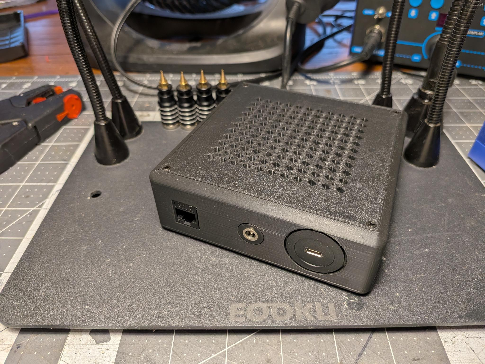
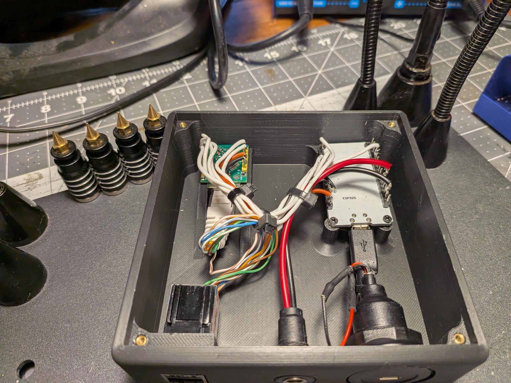
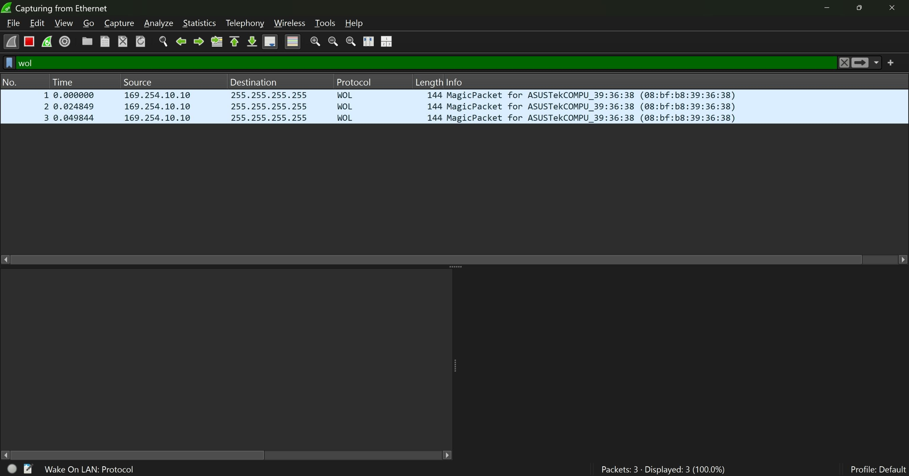
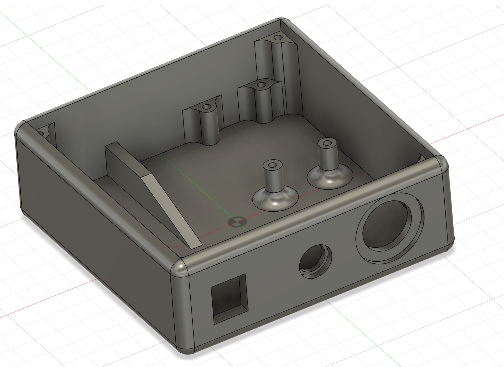
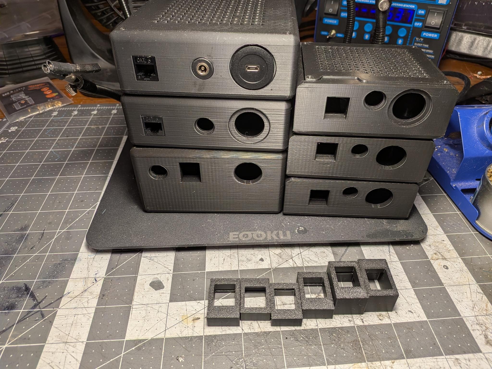
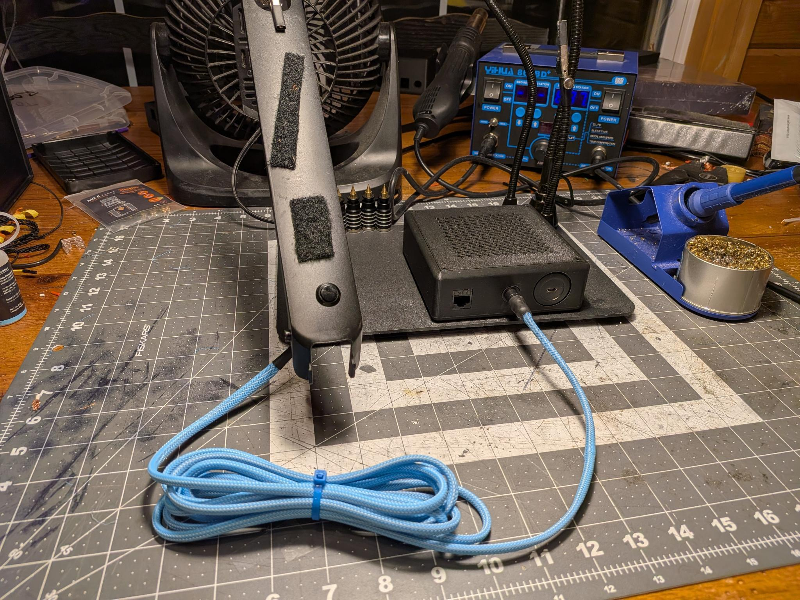

# ESP32 + W5500 Wake-on-LAN Button

A physical button that wakes a computer over Ethernet.

No Wi-Fi, app, or cloud service. Just a button and a cable.

## Why I made it

I built this for my mom. She usually works from the couch, and we moved her laptop out of the way of accidental spills. That solved one problem but made the computer's power button a pain to reach.

So I made an external button she could keep right where she sits.

## How it works

It's an ESP32 connected to a W5500 Ethernet module.

The first time you set it up, you hold the button while powering it on. It listens for Ethernet traffic from the target computer, learns its MAC address, and saves it in the ESP32's flash memory.

After that, one button press sends three Wake-on-LAN packets to the saved MAC address. The computer still has to support Wake-on-LAN and have it enabled.

## Things I learned building it

The W5500 runs from the ESP32's 3.3 V rail. Early on, the Ethernet module was flaky and sometimes didn't start cleanly.

I disabled Wi-Fi because the device uses wired Ethernet. The startup problem stopped appearing afterward, although I haven't established the root cause. The firmware does not explicitly disable Bluetooth.

I designed and printed the enclosure in Fusion, wired the hardware, and checked the Wake-on-LAN packets in Wireshark.

## Parts

| Part | Link |
| --- | --- |
| ESP32 development board | [Board](https://www.amazon.com/dp/B08D5ZD528) |
| W5500 Ethernet module | [Module](https://www.amazon.com/dp/B08KXM8TKJ) |
| Momentary push button | [Button](https://www.amazon.com/dp/B0CLG7Z5JS) |
| USB bulkhead | [Connector](https://www.amazon.com/dp/B0D17N33TX) |
| Button bulkhead | [Connector](https://www.amazon.com/dp/B0D9B7WR23) |
| RJ45 keystone | [Jack](https://www.amazon.com/dp/B09W8RST25) |
| Screws | [Screws](https://www.amazon.com/dp/B0D2R68YBC) |
| Heat-set inserts | [Inserts](https://www.amazon.com/dp/B0CS6YVJYD) |
| Ethernet cable | [Cable](https://www.amazon.com/dp/B0B57RDX6P) |
| USB cable | [Cable](https://www.amazon.com/dp/B07232M876) |
| Punchdown tool | [Tool](https://www.amazon.com/dp/B0072K1QHM) |

I cut and shortened the USB and Ethernet cables to fit the enclosure.

## Wiring

| Connection | ESP32 pin | W5500 pin |
| --- | --- | --- |
| SPI MOSI | GPIO 23 | MOSI |
| SPI MISO | GPIO 19 | MISO |
| SPI clock | GPIO 18 | SCK |
| SPI chip select | GPIO 5 | CS |
| Reset | GPIO 4 | RST |
| Power | 3V3 | VCC |
| Ground | GND | GND |
| Button | GPIO 27 | To ground through the button |

The button uses the ESP32's internal pull-up resistor.

## Build it

1. Wire the ESP32, Ethernet module, and button as shown above.
2. Open [the Arduino sketch](src/wol_button/wol_button.ino) and flash it to the ESP32.
3. Hold the button while powering the device on to enter learning mode.
4. Make the target computer send Ethernet traffic so the button can learn its MAC address.
5. Let the device save the MAC and restart.
6. Press the button to send the Wake-on-LAN packet.

This isn't a kit, and the exact pinout and power requirements can vary between boards. Check your parts rather than assuming every ESP32 and W5500 module is wired the same way.

## Enclosure and installation

The Fusion enclosure is available as [Enclosure.stl](mechanical/Enclosure.stl).

I went through several versions because I wanted the keystone to snap in tightly instead of rattling around.

The finished button mounts on the cable raceway of my mom's monitor arm. I sleeved the cable with leftover PC wiring loom because the bare cable looked awful.

## About the firmware

I designed and built the hardware and used AI assistance while writing and debugging the Arduino firmware. I tested the finished button and checked its Wake-on-LAN packets in Wireshark.

## If you build your own

This is documentation of a personal build, not a validated commercial kit. Hardware revisions and pin assignments can vary. Verify the wiring, board voltage, and modified cable connections before powering a similar device. The files are provided as-is, without a warranty of suitability for other hardware.

## License

MIT. See [LICENSE](LICENSE).
